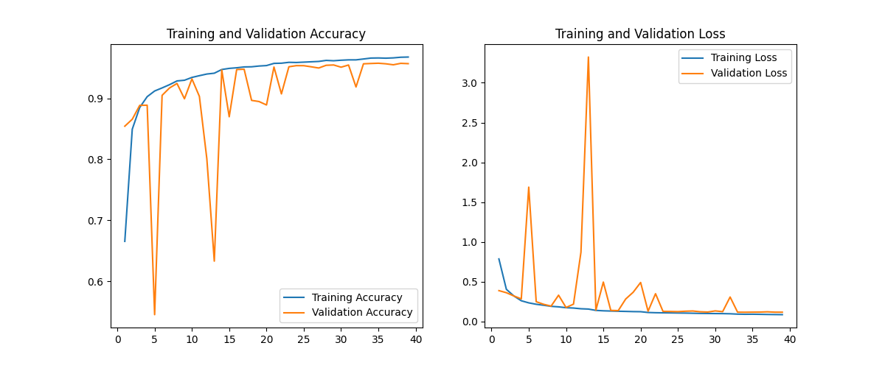
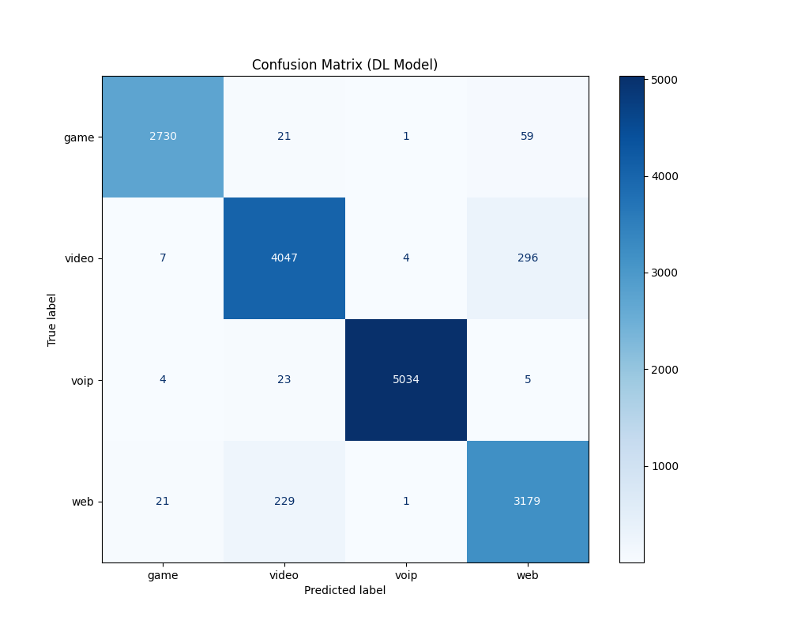
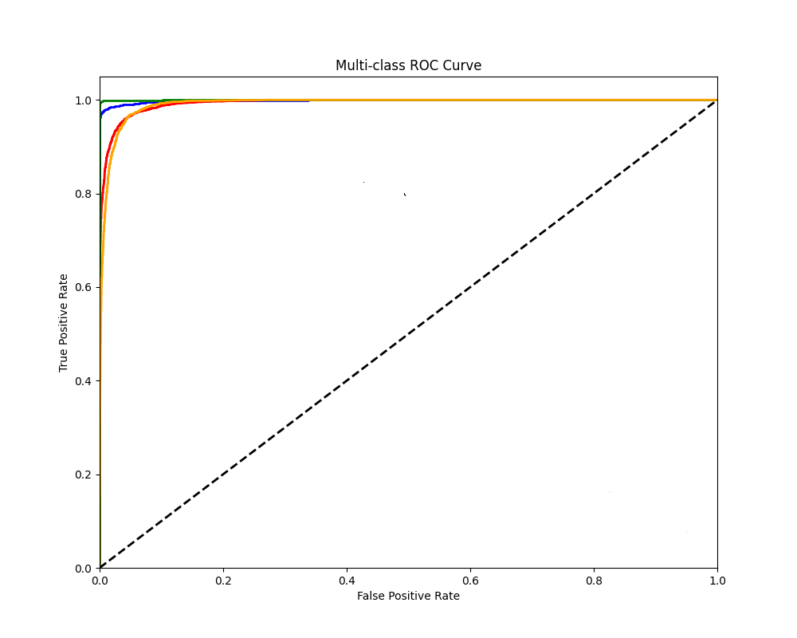

# Application Classification Based on Network Traffic

A deep learning-based network traffic classification project developed as part of the Computer Networks course project (**CO3119**, HCMUT — Team **netRunner**). This repository covers the complete offline machine learning pipeline up to **data preprocessing, feature extraction, model training, and evaluation**.

---

## 1. Introduction

With the widespread adoption of encrypted transport protocols (HTTPS/TLS/SSL), traditional Deep Packet Inspection (DPI) methods have become ineffective or privacy-invasive. However, even when packet payloads are encrypted, flow-level statistical and behavioral characteristics—such as packet sizes, inter-arrival timing, and traffic direction—still distinguish different types of network applications.

This project classifies encrypted network traffic into four application categories without inspecting packet payloads:
- **Game**
- **Video**
- **VoIP**
- **Web**

---

## 2. Methodology

### 2.1 Data Collection & Preprocessing (`src/chop_pcaps.py`)
- **Raw Dataset**: 207 `.pcap`/`.pcapng` files sourced from the MIT Lincoln Laboratory VNAT dataset and self-collected traffic captures across the four target categories.
- **Sliding Window Segmentation**: Large capture files are segmented into smaller chunks using a time-based sliding window (`duration = 4.0s`, `step_size = 2.0s`).
- **Noise Filtering**: Chunks containing fewer than `20` packets are discarded, yielding **78,303** labeled traffic samples.

### 2.2 Feature Extraction (`src/extract_features.py`)
Each PCAP chunk is converted into a fixed-length sequence of **300 packets** (zero-padded if shorter) with **3 numerical features** per packet, producing arrays of shape `(78303, 300, 3)`:
1. **Packet Size (`bytes`)**: Total length of each packet.
2. **Inter-Arrival Time (`IAT`, seconds)**: Time elapsed between consecutive packets (`0.0` for the first packet).
3. **Direction (`+1` / `-1` / `0`)**: Uplink (`+1`) or Downlink (`-1`) relative to the monitored device's private IP (automatically inferred from the most frequent RFC 1918 private IP address in the capture).

Features are normalized to `[0, 1]` using `MinMaxScaler`, and labels are encoded via `LabelBinarizer`.

### 2.3 Hybrid Deep Learning Architecture (`src/train.py`)
A hybrid **1D-CNN + LSTM** model (**48,484 parameters**) is used to capture both local packet-burst patterns and long-range temporal dependencies:

```
Input (300, 3)
  -> Conv1D (64 filters, kernel=3, ReLU) -> BatchNormalization
  -> Conv1D (64 filters, kernel=3, ReLU) -> MaxPooling1D (pool_size=2) -> Dropout (0.2)
  -> LSTM (64 units) -> Dropout (0.2)
  -> Dense (32, ReLU) -> Dense (4, Softmax)
```

- **Training Setup**: 80/20 stratified train-test split (`random_state=36`), Adam optimizer, Categorical Crossentropy loss, `batch_size=32`, up to `100` epochs with `EarlyStopping(patience=5)` and `ReduceLROnPlateau(factor=0.5, patience=3)`.

---

## 3. Evaluation Results

### 3.1 Training Performance
Thanks to `EarlyStopping` and `ReduceLROnPlateau` (triggered at epochs 13, 20, 32, and 37), the model converged cleanly at **Epoch 39**:
- **Training Accuracy**: `96.78%` | **Training Loss**: `0.0875`
- **Validation Accuracy**: `95.69%` | **Validation Loss**: `0.1183`



### 3.2 Test Set Performance (15,661 Samples)
Evaluated on an unseen test split of **15,661 samples**, the model achieved **96% overall accuracy**:

| Class | Precision | Recall | F1-Score | Support |
| :--- | :---: | :---: | :---: | :---: |
| **game** | 0.99 | 0.97 | 0.98 | 2,811 |
| **video** | 0.94 | 0.93 | 0.93 | 4,354 |
| **voip** | 0.99 | 0.99 | 0.99 | 5,066 |
| **web** | 0.90 | 0.93 | 0.91 | 3,430 |
| **Accuracy / Macro Avg** | **0.96** | **0.96** | **0.96** | **15,661** |





### 3.3 Error Analysis
- **VoIP** (`F1 = 0.99`, 5,034/5,066 correct) and **Game** (`F1 = 0.98`, 2,730/2,811 correct) are separated with very high precision, showing that expanding the sequence window to 300 packets effectively captures low-latency interactive patterns.
- **Video vs. Web** accounts for the majority of misclassifications (296 Video samples predicted as Web; 229 Web samples predicted as Video), primarily because both traffic types exhibit similar bursty download behaviors.
- All four classes achieve near-1.00 area under the ROC curve (`ROC-AUC ≈ 1.00`).

---

## 4. Conclusion & Limitations

### Conclusion
The hybrid **1D-CNN + LSTM** approach successfully classifies encrypted application traffic using only packet-level metadata (`Size`, `IAT`, `Direction`), achieving **96% accuracy** across 15,661 test samples without relying on payload inspection.

### Limitations
- **Video vs. Web Overlap**: Bursty content-loading patterns in modern web browsing closely resemble adaptive video streaming chunks.
- **Initial Buffering Requirement**: Fixed 300-packet sequences require collecting sufficient packets before classification, which can limit accuracy or introduce delay on very short-lived flows.

---

## 5. Repository Structure & Usage

```text
├── output/
│   ├── X.npy, y.npy               # Extracted feature and label arrays (78,303 samples)
│   ├── traffic_model_dl.keras     # Trained 1D-CNN + LSTM model
│   ├── scaler_dl.joblib           # Fitted MinMaxScaler
│   ├── encoder_dl.joblib          # Fitted LabelBinarizer
│   ├── result.txt                 # Full training & evaluation log
│   └── *.png                      # Training history, confusion matrix, ROC curve
└── src/
    ├── chop_pcaps.py              # Sliding-window PCAP chunking
    ├── extract_features.py        # Packet sequence feature extraction
    ├── train.py                   # Model training and evaluation
    └── test.py                    # Single-PCAP inference script
```

### Dependencies
```bash
pip install numpy scikit-learn tensorflow scapy joblib matplotlib tqdm
```

### Pipeline Commands
```bash
# 1. Split raw PCAP/PCAPNG files into 4s sliding-window chunks
python src/chop_pcaps.py --pcap_dir <raw_pcaps_dir> --out_dir <chunks_dir>

# 2. Extract 300-packet sequence features (run from or output to output/)
python src/extract_features.py --pcap_dir <chunks_dir> --out_dir output

# 3. Train and evaluate the model (run inside output/ where X.npy and y.npy reside)
cd output && python ../src/train.py

# 4. Predict application type for a single PCAP file
python src/test.py <sample.pcap> --model output/traffic_model_dl.keras --scaler output/scaler_dl.joblib --encoder output/encoder_dl.joblib
```
